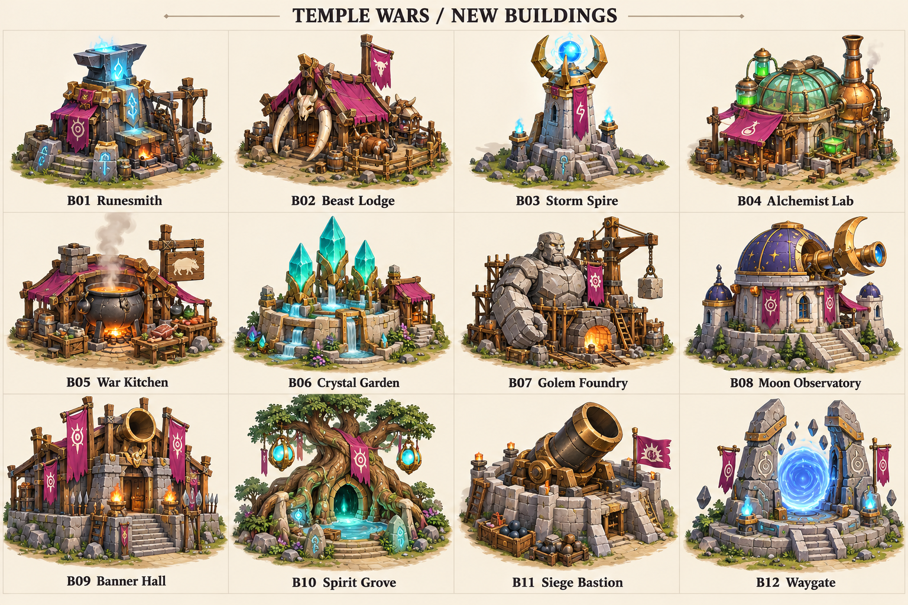
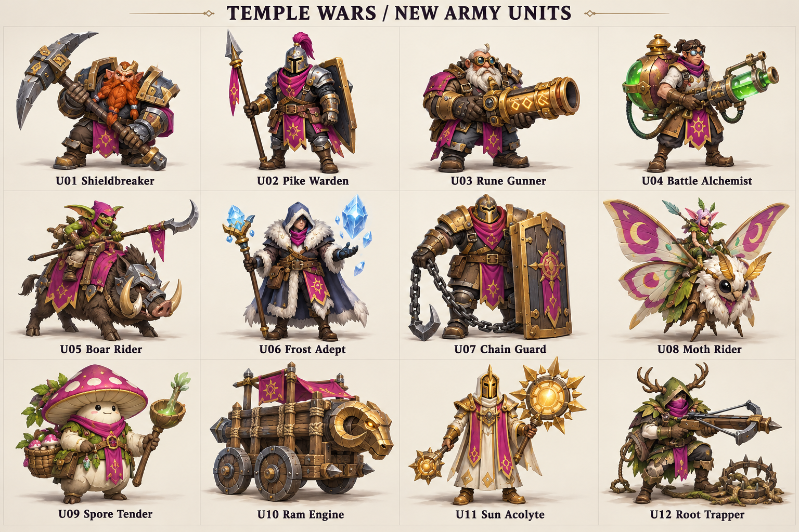
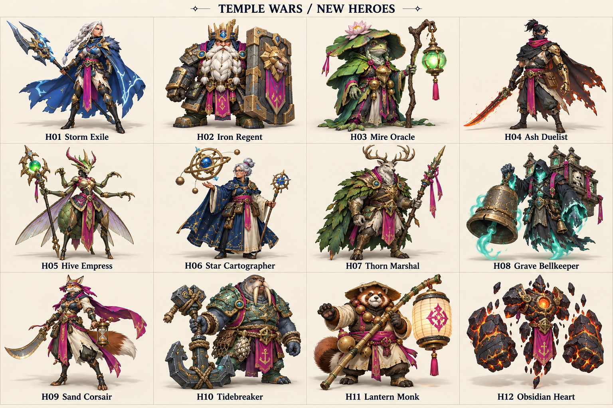
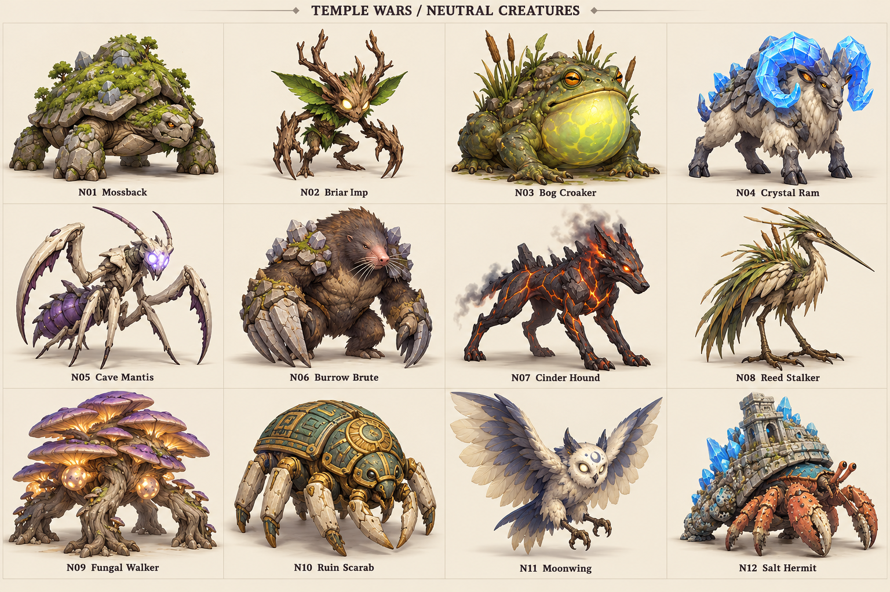
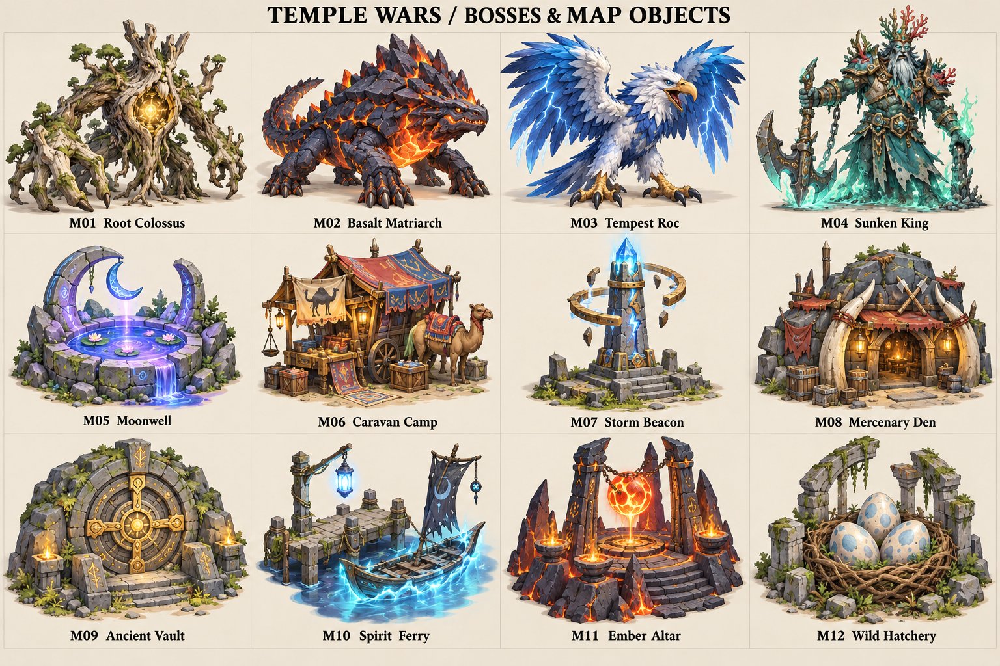

# Temple Wars — 60 нових концептів

П’ять аркушів по 12 концептів. Коди йдуть зліва направо, зверху вниз. Це пропозиції для вибору, без змін ігрових даних чи балансу. Ролі нижче — початкові ідеї для обговорення.

Згенеровано вбудованим image_gen. Повні промпти: [prompts.json](./prompts.json).

## TEMPLE WARS / NEW BUILDINGS

| Код | Назва | Можлива роль |
|---|---|---|
| B01 | Runesmith | Посилення зброї рунами. |
| B02 | Beast Lodge | Навчання та покращення бойових звірів. |
| B03 | Storm Spire | Оборонна вежа з ланцюговою блискавкою. |
| B04 | Alchemist Lab | Навчання алхіміків і покращення зілля. |
| B05 | War Kitchen | Тимчасове посилення армії їжею. |
| B06 | Crystal Garden | Додаткове джерело магічного ресурсу. |
| B07 | Golem Foundry | Виробництво повільних важких конструктів. |
| B08 | Moon Observatory | Розвідка та виявлення прихованих ворогів. |
| B09 | Banner Hall | Аури командування й поліпшення загонів. |
| B10 | Spirit Grove | Лікування та виклик лісових духів. |
| B11 | Siege Bastion | Далекобійна стаціонарна артилерія. |
| B12 | Waygate | Переміщення підкріплень між базами. |

## TEMPLE WARS / NEW ARMY UNITS

| Код | Назва | Можлива роль |
|---|---|---|
| U01 | Shieldbreaker | Руйнує броню важких цілей. |
| U02 | Pike Warden | Тримає стрій проти кавалерії. |
| U03 | Rune Gunner | Повільно стріляє, пробиває броню. |
| U04 | Battle Alchemist | Зони отрути та підтримка зіллям. |
| U05 | Boar Rider | Швидкий фланговий напад. |
| U06 | Frost Adept | Сповільнює групи ворогів. |
| U07 | Chain Guard | Чіпляє та підтягує одну ціль. |
| U08 | Moth Rider | Повітряна розвідка й підтримка. |
| U09 | Spore Tender | Періодичне лікування спорами. |
| U10 | Ram Engine | Облога під прикриттям навісу. |
| U11 | Sun Acolyte | Захист союзників від магії. |
| U12 | Root Trapper | Ставить пастки й утримує проходи. |

## TEMPLE WARS / NEW HEROES

| Код | Назва | Можлива роль |
|---|---|---|
| H01 | Storm Exile | Мобільний боєць із блискавками та ривками. |
| H02 | Iron Regent | Танк-командир зі щитом і захистом союзників. |
| H03 | Mire Oracle | Болотний маг із туманом, прокляттями й лікуванням. |
| H04 | Ash Duelist | Дуелянт із жаром, парируванням і ривком. |
| H05 | Hive Empress | Закликає рій і позначає цілі. |
| H06 | Star Cartographer | Зоряні зони контролю та короткі телепорти. |
| H07 | Thorn Marshal | Танк із корінням і колючою бронею. |
| H08 | Grave Bellkeeper | Контроль страхом і примарним дзвоном. |
| H09 | Sand Corsair | Швидкий боєць із піщаними приманками. |
| H10 | Tidebreaker | Важкий ініціатор із хвилями й якорем. |
| H11 | Lantern Monk | Підтримка з ліхтарями, бар’єрами та ударами посоха. |
| H12 | Obsidian Heart | Повільний маг-танк із перегрівом і лавовими ударами. |

## TEMPLE WARS / NEUTRAL CREATURES

| Код | Назва | Можлива роль |
|---|---|---|
| N01 | Mossback | Живучий мешканець лісових таборів. |
| N02 | Briar Imp | Слабкий кріп, що нападає зграєю. |
| N03 | Bog Croaker | Стрибок і атака язиком. |
| N04 | Crystal Ram | Розгін і таран із відкиданням. |
| N05 | Cave Mantis | Засідки та швидкі удари. |
| N06 | Burrow Brute | Підземний вихід і оглушення. |
| N07 | Cinder Hound | Швидкий напад із підпалом. |
| N08 | Reed Stalker | Дальня атака дзьобом із очерету. |
| N09 | Fungal Walker | Хмари спор та дрібні грибні істоти. |
| N10 | Ruin Scarab | Броньований охоронець руїн. |
| N11 | Moonwing | Нічна літаюча істота з дезорієнтацією. |
| N12 | Salt Hermit | Повільний захисник із міцним панциром. |

## TEMPLE WARS / BOSSES & MAP OBJECTS

| Код | Назва | Можлива роль |
|---|---|---|
| M01 | Root Colossus | Бос: коріння на площі й виклик паростків. |
| M02 | Basalt Matriarch | Бос: броня, що тріскається, та лавові зони. |
| M03 | Tempest Roc | Бос: повітряні нальоти й грозові ділянки. |
| M04 | Sunken King | Бос: водяні хвилі й примарна варта. |
| M05 | Moonwell | Точка відновлення мани, за яку можна боротися. |
| M06 | Caravan Camp | Мандрівна крамниця зі змінним асортиментом. |
| M07 | Storm Beacon | Точка захоплення для огляду території. |
| M08 | Mercenary Den | Найм незвичайних нейтральних юнітів. |
| M09 | Ancient Vault | Скарбниця, яку відкривають після випробування. |
| M10 | Spirit Ferry | Можливий маршрут через водну перешкоду. |
| M11 | Ember Altar | Ризикований ритуал за тимчасове посилення. |
| M12 | Wild Hatchery | Об’єкт для отримання істоти-союзника. |

