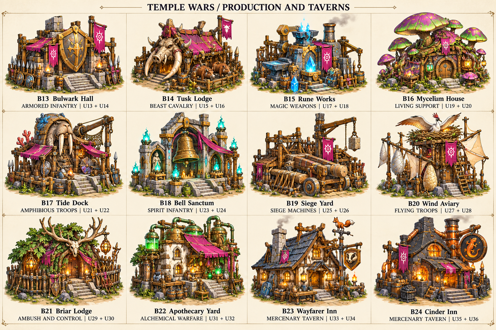
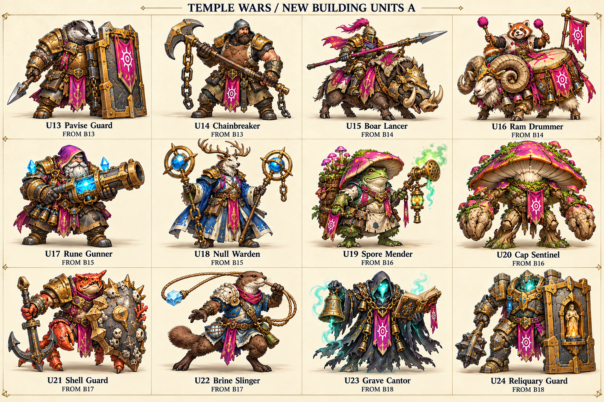
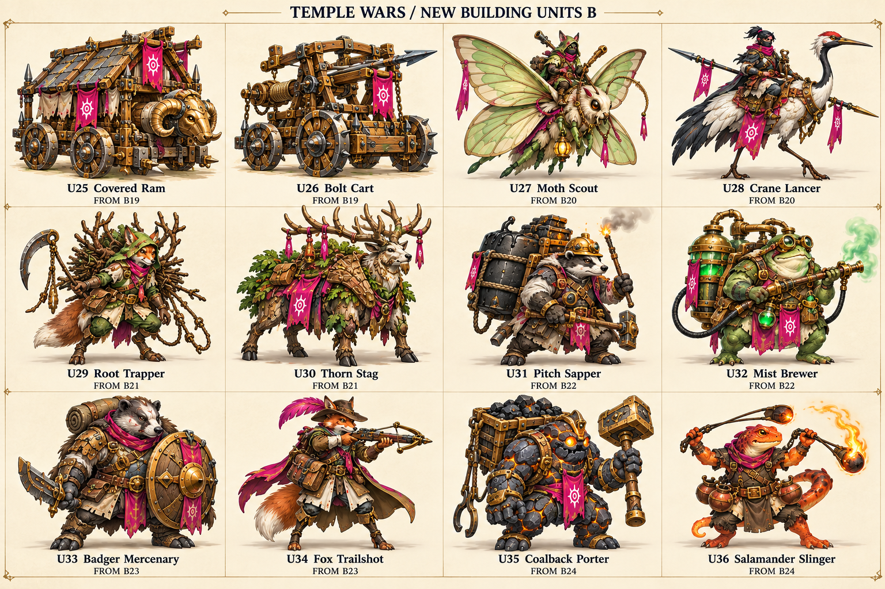
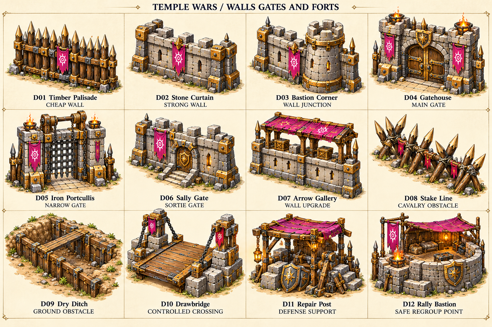
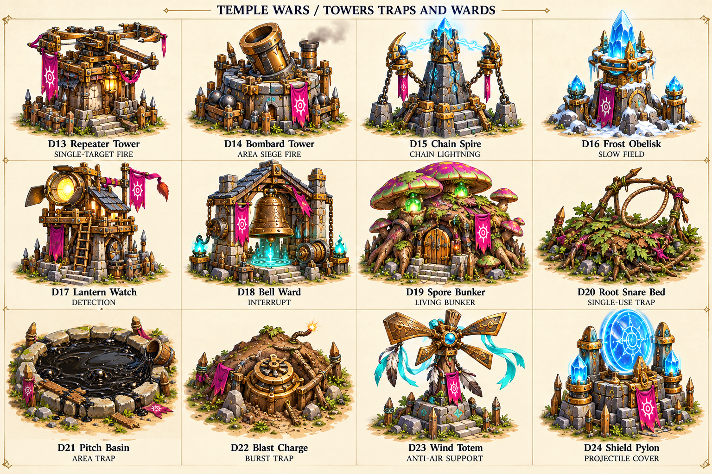
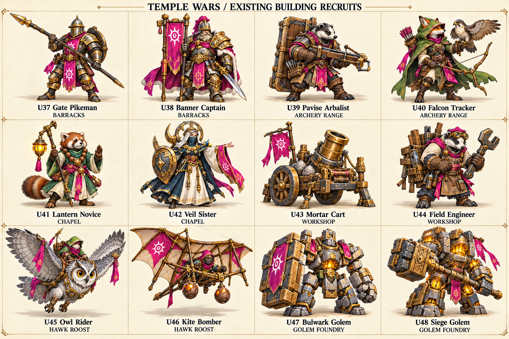

# Temple Wars — 72 production and defense concepts

Six sheets of twelve concepts. Read left to right, top to bottom. All roles are proposals; no game stats or balance are changed. New building branches are alternatives to select from, not a requirement to add all of them.

The previous B01–B12 and U01–U12 codes are kept. New buildings B13–B24 pair with U13–U36. Existing-building recruits use U37–U48. Defenses use D01–D24.

Production chains: **building → two recruit concepts → battlefield role and counterplay**. The two new inns hire mercenaries with hero gold instead of training faction troops.

Generated with built-in image_gen. Prompts: [prompts.json](./prompts.json). Structured selection catalog: [catalog.json](./catalog.json).

## PRODUCTION AND TAVERNS

| Code | Name | Source / recruits | What it does | Weakness |
|---|---|---|---|---|
| B13 | Bulwark Hall | U13 + U14 | Trains shield infantry and armor breakers. Unlocks a shield-wall stance. | Slow troops; weak against siege and flanking. |
| B14 | Tusk Lodge | U15 + U16 | Trains boar cavalry and mounted war drummers. | Needs room to charge; vulnerable in narrow lanes. |
| B15 | Rune Works | U17 + U18 | Trains rune gunners and anti-magic wardens. | Costly troops with slow attacks and long recovery. |
| B16 | Mycelium House | U19 + U20 | Grows spore healers and mushroom sentinels. | Strong near a position; weak while moving and against fire. |
| B17 | Tide Dock | U21 + U22 | Trains shell guards and brine slingers; troops cross shallow water. | Short range; vulnerable to long-range weapons. |
| B18 | Bell Sanctum | U23 + U24 | Trains grave cantors and reliquary guards. | Needs mana and a protected support line. |
| B19 | Siege Yard | U25 + U26 | Builds covered rams and bolt carts. | Machines are slow and need infantry escorts. |
| B20 | Wind Aviary | U27 + U28 | Trains moth scouts and crane lancers. | Light flyers lose to dedicated anti-air. |
| B21 | Briar Lodge | U29 + U30 | Trains root trappers and armored thorn stags. | Traps need preparation; weak in open frontal fights. |
| B22 | Apothecary Yard | U31 + U32 | Trains pitch sappers and mist brewers. | Fragile troops; fire and mist need careful positioning. |
| B23 | Wayfarer Inn | U33 + U34 | Hires badger guards and fox scouts for hero gold. A limited roster rests between hires. | Higher gold cost and limited stock. |
| B24 | Cinder Inn | U35 + U36 | Hires coalback porters and salamander slingers. | Slow reserves and short-ranged fire attacks. |

## NEW BUILDING UNITS A

| Code | Name | Source / recruits | What it does | Weakness |
|---|---|---|---|---|
| U13 | Pavise Guard | B13 | Blocks ranged fire from the front. | Slow to turn; flank or use siege. |
| U14 | Chainbreaker | B13 | Cracks heavy armor with slow maul strikes. | Low attack speed; kite with light ranged units. |
| U15 | Boar Lancer | B14 | Charges ranged troops and attacks the back line. | Pikes and roots stop the charge. |
| U16 | Ram Drummer | B14 | A drum rhythm speeds nearby allied attacks. | Weak damage and exposed without escorts. |
| U17 | Rune Gunner | B15 | Fires slow armor-piercing rune shots. | Weak against swarms and fast melee. |
| U18 | Null Warden | B15 | Raises a brief anti-magic screen for nearby allies. | Limited mana; ordinary physical attacks still hurt. |
| U19 | Spore Mender | B16 | Leaves short-lived healing patches for allies. | Patches are stationary; fragile when chased. |
| U20 | Cap Sentinel | B16 | A rooted guard releases slowing spores. | Cannot move while rooted; vulnerable to siege. |
| U21 | Shell Guard | B17 | A durable amphibious front-line fighter. | Slow inland; vulnerable to armor breakers. |
| U22 | Brine Slinger | B17 | Salt shots briefly reduce enemy healing. | Short range and little armor. |
| U23 | Grave Cantor | B18 | A bell chant weakens enemy attacks in an area. | Silence or kill the fragile caster. |
| U24 | Reliquary Guard | B18 | Takes part of a nearby ally's damage. | Focus the guard or separate the pair. |

## NEW BUILDING UNITS B

| Code | Name | Source / recruits | What it does | Weakness |
|---|---|---|---|---|
| U25 | Covered Ram | B19 | Breaks gates and buildings under an arrow-proof roof. | No anti-unit attack; vulnerable to fire and melee. |
| U26 | Bolt Cart | B19 | A long bolt pierces a straight line of enemies. | Slow reload and a weak side profile. |
| U27 | Moth Scout | B20 | Fast air scout that reveals a small area. | Very fragile and deals little damage. |
| U28 | Crane Lancer | B20 | A diving flyer that can strike other air units. | Vulnerable during dive recovery. |
| U29 | Root Trapper | B21 | Places a root snare that holds the first enemy. | Traps can be revealed; weak in direct combat. |
| U30 | Thorn Stag | B21 | Knocks back enemies after a straight charge. | Cannot turn during the charge; pikes punish it. |
| U31 | Pitch Sapper | B22 | Throws pitch charges against buildings and walls. | Must get close; very weak if caught. |
| U32 | Mist Brewer | B22 | Makes a mist cloud that reduces ranged accuracy. | Cloud also limits allied shots through it. |
| U33 | Badger Mercenary | B23 | A tough hire that protects a hero. | High gold cost and slow movement. |
| U34 | Fox Trailshot | B23 | A mobile hired skirmisher that marks targets. | Fragile; loses sustained fights. |
| U35 | Coalback Porter | B24 | A sturdy hire that repairs nearby allied constructs. | Slow; weak against magic and kiting. |
| U36 | Salamander Slinger | B24 | Burning globes damage tightly packed ground troops. | Short range; weak against air and split armies. |

## WALLS GATES AND FORTS

| Code | Name | Source / recruits | What it does | Weakness |
|---|---|---|---|---|
| D01 | Timber Palisade | Cheap wall | Blocks ground movement early. | Fire and siege break it quickly. |
| D02 | Stone Curtain | Strong wall | A durable wall segment with clear connection ends. | Needs space and loses to dedicated siege. |
| D03 | Bastion Corner | Wall junction | A reinforced corner connects two wall directions. | More expensive than a straight segment. |
| D04 | Gatehouse | Main gate | A wide gate opens for allies and closes against enemies. | The main breach target; needs repair support. |
| D05 | Iron Portcullis | Narrow gate | A compact heavy gate holds a choke point. | Slow to raise; vulnerable while opening. |
| D06 | Sally Gate | Sortie gate | A narrow ally gate allows short counterattacks. | Low capacity; poor as the main entrance. |
| D07 | Arrow Gallery | Wall upgrade | A firing platform shelters ranged defenders. | Siege and flank attacks remain dangerous. |
| D08 | Stake Line | Cavalry obstacle | Slows charges and hurts mounted ground attackers. | Infantry and siege can clear it. |
| D09 | Dry Ditch | Ground obstacle | A shallow ditch slows ground advances. | Flyers ignore it; builders can fill a breach. |
| D10 | Drawbridge | Controlled crossing | Opens or closes one narrow crossing. | Requires a suitable gap; exposed lifting chains. |
| D11 | Repair Post | Defense support | Nearby workers repair defenses faster. | No attack; an exposed support target. |
| D12 | Rally Bastion | Safe regroup point | A small shelter helps resting defenders recover outside combat. | No recovery during combat; siege can force it empty. |

## TOWERS TRAPS AND WARDS

| Code | Name | Source / recruits | What it does | Weakness |
|---|---|---|---|---|
| D13 | Repeater Tower | Single-target fire | Fast bolts punish light ground and air units. | Weak against heavy armor and siege. |
| D14 | Bombard Tower | Area siege fire | Slow shells damage clustered ground attackers. | Cannot hit air; dangerous minimum range. |
| D15 | Chain Spire | Chain lightning | Lightning jumps across closely packed enemies. | Weak against single targets and spread formations. |
| D16 | Frost Obelisk | Slow field | Ice pulses slow nearby ground enemies. | Low damage and a limited field. |
| D17 | Lantern Watch | Detection | Reveals hidden enemies and grants long sight. | Little direct damage; protect it behind walls. |
| D18 | Bell Ward | Interrupt | A charged bell pulse interrupts nearby spellcasting. | Long recovery between pulses; weak to physical siege. |
| D19 | Spore Bunker | Living bunker | Tough fungal cover sends spores at nearby attackers. | Fire and long-range siege counter it. |
| D20 | Root Snare Bed | Single-use trap | Roots the first ground enemy crossing it. | Revealed by scouts; triggers on cheap troops. |
| D21 | Pitch Basin | Area trap | Sticky pitch slows a group entering its area. | No air effect; only protects a small patch. |
| D22 | Blast Charge | Burst trap | A buried charge bursts after an enemy steps close. | One use; can be revealed and cleared. |
| D23 | Wind Totem | Anti-air support | A gust pushes back low-flying attackers. | No effect on ground siege. |
| D24 | Shield Pylon | Projectile cover | Briefly shields nearby defenses from ranged volleys. | A short duration; melee and siege pressure exhaust it. |

## EXISTING BUILDING RECRUITS

| Code | Name | Source / recruits | What it does | Weakness |
|---|---|---|---|---|
| U37 | Gate Pikeman | Barracks | Braces a long pike near allied defenses to stop charges. | Weak while moving; ranged troops can kite it. |
| U38 | Banner Captain | Barracks | A small nearby armor aura helps a tight infantry line. | Low solo damage; the enemy can focus the captain. |
| U39 | Pavise Arbalist | Archery Range | Heavy crossbow shots from behind a portable shield. | Slow reload; weak against flankers. |
| U40 | Falcon Tracker | Archery Range | A trained falcon reveals hidden enemies ahead. | Weak sustained damage and low armor. |
| U41 | Lantern Novice | Chapel | Places a small stationary healing lantern for allies. | The lantern can be destroyed; fragile caster. |
| U42 | Veil Sister | Chapel | Cleanses one harmful spell and grants a short magic barrier. | Limited mana and little attack damage. |
| U43 | Mortar Cart | Workshop | Arcing shells punish units hiding behind walls. | Cannot hit air; poor at close range. |
| U44 | Field Engineer | Workshop | Repairs machines and builds a small temporary barricade. | Almost no attack; needs protection. |
| U45 | Owl Rider | Hawk Roost | Night scout with a wide detection sweep. | Light armor and low combat damage. |
| U46 | Kite Bomber | Hawk Roost | Drops a short line of bombs on ground targets. | Weak against air units and during the turn back. |
| U47 | Bulwark Golem | Golem Foundry | A stone shield construct covers nearby ranged troops. | Slow and weak against melee armor breakers. |
| U48 | Siege Golem | Golem Foundry | A slow two-handed hammer breaks buildings and gates. | Low mobility; weak against fast ranged armies. |

## Existing production buildings

The twelve new recruit concepts are additions to these current rosters, not replacement skins.

- **Barracks** currently trains: swordsman, lancer, pike_warden.
- **Archery Range** currently trains: archer.
- **Chapel** currently trains: cleric, frost_adept.
- **Workshop** currently trains: catapult.
- **Hawk Roost** currently trains: hawk_rider.
- **Golem Foundry** currently trains: foundry_golem.
