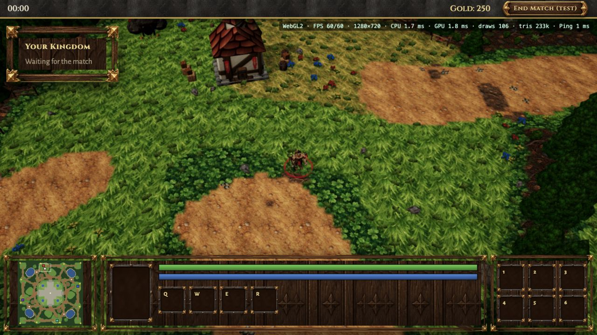
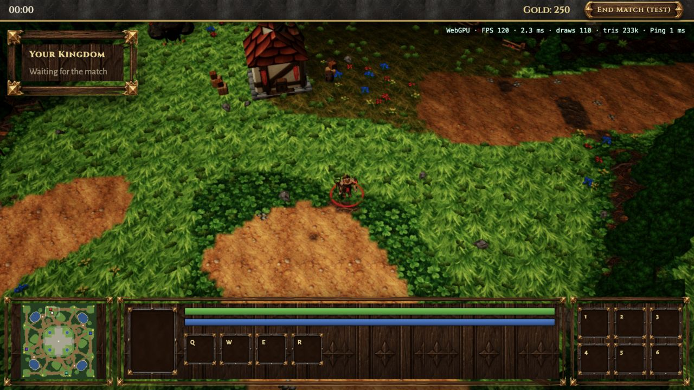

# Client audit — 2026-10-19

Scope: improve the existing Phase 5 client. No multiplayer, combat or AI work.

Current display preference: 120 FPS in game and native display resolution. The temporary 1080p/1.5-DPR limit was removed after the user reported a blurry hero. Menus remain at 30 FPS. The 60 FPS power observations below describe the earlier experiment, not the current configuration.

## Follow-up: input, GPU load and lighting

The first audit focused too much on FPS. A 120 FPS cap still lets the game use substantial GPU time, especially with a Retina drawing buffer.

- Fixed vertical edge scrolling: top and bottom HUD panels were intercepting pointer movement. The camera now tracks window pointer movement, clears it when the pointer leaves the window or focus is lost, and normalizes diagonal movement. Verified north/south scrolling over the HUD in the browser and with a client regression test.
- Rendering now caps at 60 FPS in game and 30 FPS in menus. Background rendering is disabled, and hidden documents skip scene rendering.
- The drawing buffer uses at most 1.5 times CSS resolution and about 2.07 million pixels. The HTML HUD stays at native display resolution. Five tests cover Retina, normal, narrow and ultra-wide windows.
- Native MSAA is disabled because the scene already uses FXAA. Full-screen bloom is off; hero particles and emissive materials remain.
- Shadows already existed for heroes and buildings. Changed the 2048 map to a camera-centered 1024 map with low-cost PCF, rather than spreading its texels across four distant bases. Tree ground shading is baked into the terrain colors; individual tree shadows are not added.
- Lighting is less yellow, sky fill is a little brighter, color contrast and vignette are reduced. Shadows are stronger locally without adding lights or shadow passes.
- F3 now labels CPU scene time, reports the drawing-buffer size and FPS limit, and shows GPU time when the renderer exposes timer queries. Unsupported timing is shown as a dash.

Short system observation, using five one-second `ioreg` samples per run in the same Mac session and window size:

| AGX Device Utilization | Before | After |
| --- | --- | --- |
| Samples | 73%, 78%, 75%, 71%, 78% | 69%, 57%, 60%, 56%, 56% |
| Median | 75% | 57% |

This measures the entire Mac GPU, including other apps. It is a short observation, not isolated game power consumption or a temperature/fan benchmark. The game held the new 60 FPS target; WebGL2 also reported about 1.6 ms GPU time at a 1270 × 1158 drawing buffer in the start area. Menu rendering was observed at 30 FPS. A longer run with temperature, energy and other apps controlled is still needed. The full-map menu overview remains heavier per frame than the close game view (about 533 draws and 1.6 million triangles in one sample).

After the changes: 36 tests passed, including 6 client tests. Both rendering paths were rechecked; a missing WebGL timer-query module found during testing was connected before the final checks.

## Browser checks

Ran the local development server and tested the in-app Chromium browser with WebGPU and forced WebGL2 (`?play&webgl`). Both loaded the map without captured console warnings or errors. Checked the start area, a temple road, the north-east edge, right-click movement, F1 camera centering and F4 test units.

HUD layout was checked at 1280 × 720, 581 × 758 and 390 × 844. All four ability slots and six item slots now fit. The minimap stays square and inside its panel. This is window resizing support, not touch control support.

Observed overlay readings at 1280 × 720 after loading settled:

| Renderer and scene | FPS | Scene CPU time | Draw calls | Active triangles |
| --- | --- | --- | --- | --- |
| WebGPU, start area | 120 | 2.4 ms | 110 | 233k |
| WebGPU, start area + F4 copies | 120 | 2.8 ms | 111 | 498k |
| WebGL2, start area | 120 | 1.8–2.1 ms | 110 | 233k |

These are sampled development overlay readings, not GPU timings, percentiles or a low-end hardware benchmark. FPS was near the display cap. Before these changes, WebGL2 at the same start view also showed about 120 FPS and 110 draws; no FPS increase is claimed. F4 briefly lowered the FPS reading while creating the copies. Its copies share animation and do not simulate independent moving units or combat.

## Fixes

- HUD: smaller frames and responsive columns prevent clipping; narrow windows place inventory below abilities. The minimap previously extended beyond its panel.
- Camera: clamp the visible ground footprint using field of view, aspect ratio and zoom. Immediate minimap jumps now clamp too. Ignore camera keys while typing or outside the game, and ignore zoom while in the menu.
- Frame loop: reuse the unit rotation quaternion and camera target objects. Following the hero returns its mover rather than creating a new point every frame.
- Shader preparation: each temporary model waits only for its own compilation jobs and is disposed in `finally`. Compilation failures now reach the existing error screen instead of being silently ignored.
- Terrain loading: close temporary decoded image bitmaps after copying their pixels.
- Navigation: replace half-cell sampling with grid traversal. Direct paths and path smoothing can no longer pass diagonally between blocked cells or skip a briefly crossed cell. Added a regression test.

## Remaining weak points

1. Ground art: grass is busy at the RTS camera distance, with clear repeated clusters. Roads have large abrupt patches and the temple paving repeats strongly. A next art pass should soften grass contrast, improve transitions and vary the temple surface using existing assets before requesting more generated art.
2. Temple composition: large paved areas look empty. Place a few existing ruins around the edges while keeping routes clear; do not fill paths with props.
3. Performance evidence: the current machine and F4 scene do not prove the integrated-GPU target. Test 1080p on weaker hardware, measure actual GPU time and frame-time percentiles, and profile camera movement through dense forest. Do not add more draw calls just to hide repetition without measuring the cost.
4. Loading: retry progress can count bytes from failed transfers twice. Cold-cache download timing, cache eviction, first-use instanced shader variants and a long memory run still need focused checks.
5. Camera: the edge check passed at the normal zoom. The full set of corners, maximum zoom, terrain heights and ultra-wide aspect ratios still needs visual coverage.
6. The minimap camera box still uses a fixed 46 × 30 rectangle; it does not track viewport aspect ratio and zoom.

## Validation

- `pnpm build`: passed.
- `pnpm typecheck`: passed.
- `pnpm test`: 30 tests passed (17 shared, 9 tools, 4 server); client has no automated browser tests.
- `pnpm lint`: passed before adding this report; changed documentation was formatted separately.

