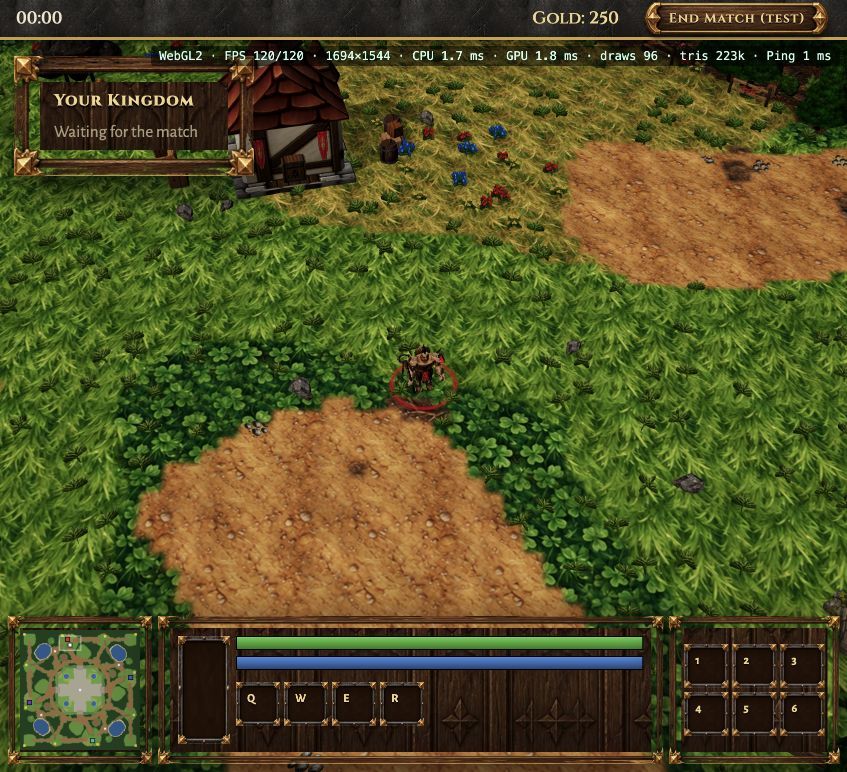
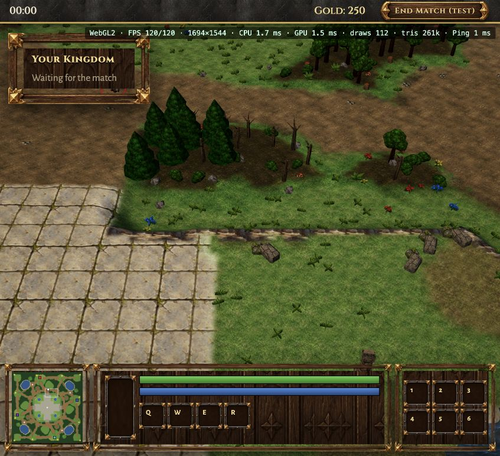
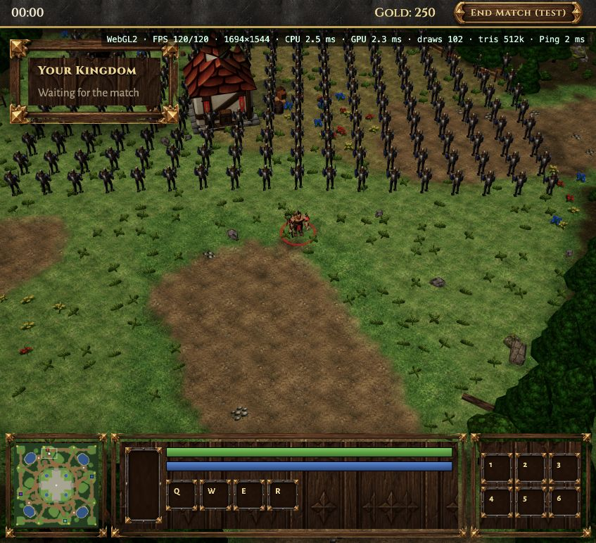

# Terrain and lighting pass — 2026-10-19

Branch: `codex/terrain-lighting-polish`.

The existing uncommitted client and map work was saved first in checkpoint `605aea8`. This pass follows that checkpoint. No merge or push to `main` is needed to review it.

## Art and lighting

Generated one 1536 × 1024 sheet with the built-in ImageGen tool. It contains six ground surfaces: meadow, lush grass, dry grass, worn earth, rough earth and forest floor. The grass has shorter blades and much quieter detail than the earlier large leaf pattern. Earth is neutral brown instead of orange. The original files remain available.

- Source: `art/raw/terrain-meadow-v2.png`.
- Prompt: `tools/art/prompts/terrain-meadow-v2.md`.
- Processed sources and 4 × 4 repeat preview: `art/source/terrain-meadow-v2/`.
- Game files: `client/public/assets/terrain/{grass,grass_lush,grass_dry,dirt,rough_dirt,forest_floor}_meadow_v2.webp`.
- Six 256 × 256 WebP files: 176,368 bytes total (about 172 KiB).
- Rebuild: `pnpm --filter @game/tools exec tsx art/terrain-meadow.ts`, then `pnpm --filter @game/tools art:manifest`.

The sun is a little more neutral and the sky fill slightly brighter. Meadow tint keeps the new quiet textures green under the warm light. Broad color patches are baked into terrain vertex colors once at load time, so the ground varies without another per-pixel noise texture. The blend uses the full cell width for softer surface transitions. Map geometry, navigation, placement and unit stats are unchanged.

## Optimization without reducing display quality

120 FPS in game and native device pixel ratio are retained. There is no drawing-buffer cap or resolution reduction in this pass.

The old terrain shader sampled four tiles at every pixel, even when all four neighboring cells used the same surface. The new GLSL and WGSL code merges weights for equal layers before sampling. A uniform patch needs one tile sample, a two-material edge usually needs two, and four different neighbors still get all four. The blend preserves each layer's total weight. Explicit texture gradients keep mip selection valid inside the branches.

No new draw calls, terrain triangles, dynamic lights or postprocessing passes were added. The tile array was increased from 128 to 256 pixels to retain detail in the new art. For ten RGBA layers and mipmaps, this costs roughly 2.5 MiB more GPU texture storage; it is not a memory reduction. The six new files are retained alongside the original files, so the asset manifest grows by about 172 KiB.

## Browser observations

In the in-app Chromium browser at a 1694 × 1544 native drawing buffer:

| Scene                          | FPS | CPU scene time | GPU time    | Draw calls | Active triangles |
| ------------------------------ | --- | -------------- | ----------- | ---------- | ---------------- |
| Before, WebGL2 start           | 120 | 1.7 ms         | 1.8 ms      | 96         | 223k             |
| New surfaces, WebGL2 start     | 120 | 1.9 ms         | 1.5–1.8 ms  | 96         | 223k             |
| New surfaces, WebGPU start     | 120 | 2.5 ms         | unavailable | 96         | 223k             |
| New surfaces, WebGL2 F4 copies | 120 | 2.3–2.5 ms     | 2.1–2.3 ms  | 102        | 512k             |

These are sampled overlay readings, not a statistically controlled power or thermal benchmark. The F4 view differed slightly from the initial camera framing, and its units share animation. GPU time is unavailable in this WebGPU session; it is not zero. No heat, wattage or whole-system GPU reduction is claimed from these readings.

Both shader languages compiled and rendered the new art. Looked at the repeat preview, the start area, surfaces around the base and the F4 scene. Development-only URL flags `terrainReference` (unmerged layer sampling) and `noShadows` allow manual graphics checks; normal play enables the optimized shader and shadows. They are not graphics settings for players.

Validation: `pnpm build`, `pnpm typecheck`, `pnpm lint`, and all 36 existing tests. Shader behavior was checked in the browser; there is no automated visual regression suite yet.

## Review images

The temple surface still uses the original tile. Foliage cards still use the existing atlas. A later art pass can group the small tufts more naturally and vary temple paving; neither requires adding gameplay systems.
