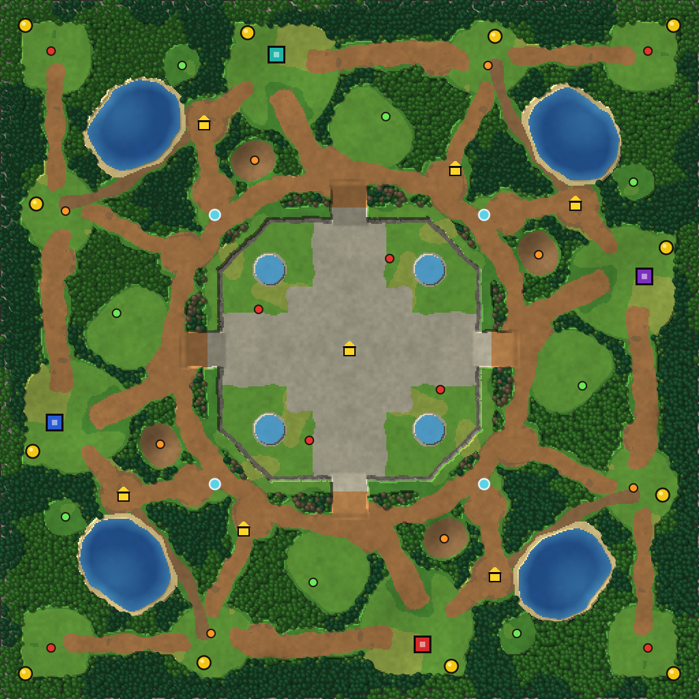

# Map — Elder Temple

Reference picture: `docs/reference/map.png` (the classic 4-player temple map layout).
Our map data (all generated, edit the scripts, not the files). `pnpm map:build` runs both scripts:
- `shared/data/map-layout.json` — points and shapes (bases, mines, camps, shops, roads, lakes, hills, temple). Made by `tools/map/make-map-layout.mjs`.
- `shared/data/map-terrain.bin` — the real terrain grid, 512 × 512 cells of 0.5 units. Made by `tools/map/bake-terrain.mjs`.
- `shared/data/map-trees.json` — every tree (7,451 trees). Same script.
- `shared/data/map-decor.json` — small props and plants (6,735 items). Same script.
- [map-preview.png](map-preview.png) — top-down picture of the baked map. Same script.

Preview legend: colored square = Town Hall (start spot), yellow circle = gold mine, yellow house = shop, light blue circle = Fountain of Life, small dots = camps (green / orange / red), grey = temple high ground with cliff edges.

## Big picture

- Size **256 × 256** game units (1 unit ≈ 1 meter). The layout is drawn on a 192 grid and scaled by 4/3 in `make-map-layout.mjs` (`S`); roads get a little extra width (`ROAD_S`).
- **Exact 4-fold rotation symmetry** around the center (128, 128). We describe the north sector once, and the script turns it by 90°, 180° and 270°. The bake checks it: 0 different cells.
- Start spots form a "pinwheel": each base sits a bit off the middle of its map side.
- Coordinates: origin in the south-west corner, x goes east, y goes north.
- The map edge is a **mountain wall** (8 units inside the map, cliff ground, can not be walked or built on). Outside the map the client draws 64 more units of mountains with pines on the lower slopes, so the world does not end at a line. The camera stops so its view stays inside the mountains.

### Walk times (measured on the nav grid, hero speed 3)

| From the north hero spawn to | Path length | Time |
|---|---|---|
| Trader's Tent (own side shop) | 35 | ~12 s |
| Own natural expansion | 77 | ~26 s |
| Fountain of Life (north-east) | 89 | ~30 s |
| Temple Market (center) | 99 | ~33 s |
| West neighbour's natural (lake trail) | 104 | ~35 s |
| Own corner expansion | 143 | ~48 s |
| Next base (east or west) | 151 | ~50 s |
| Opposite base (south) | 199 | ~66 s |

## What is in one sector (north shown, same for all four)

| Thing | Position (north) | Notes |
|---|---|---|
| Town Hall | (101, 236) | Start spot. Hero spawns at (107, 224). Stands on a low rise (`base_rise`). |
| Base build area | circle (104, 228), r 20 | AI places buildings here. A broken fence ring, crates and barrels mark it. |
| Main gold mine | (91, 244) | 20,000 gold. |
| Natural expansion | mine (181, 243), open area (179, 233) r 15 | 14,000 gold. Guarded by Orange Trolls. |
| Corner expansion | mine (247, 247), open area (236, 236) r 13 | 16,000 gold. Guarded by Red Ogres. Only reachable along the road from the natural. |
| Trader's Tent (side shop) | (75, 211) | Between the base and the lake. |
| Lake | ellipse at (49, 211), 17 × 15 | Blocks ground units. Flying units cross it. Sits in a low dip. |
| Green Wolves | (67, 232) | West of the base. |
| Green Bandits | (141, 213) | In the open **field** between the base and the ring road. |
| Orange Harpies | (93, 197) | On the **watch hill**, above the base → ring road. |
| Red Sentinels | (143, 161) | On the temple plateau near the north ramp. |
| Temple ramp | from (128, 188) up to (128, 173), width 13 | One per side, 4 in total. |
| Fountain of Life | (177, 177) | On the ring road, between north and east. 4 in total. |

## The center

- **Temple plateau** — high ground (level 1), an octagon about 96 × 96 units. Edges are cliffs except the 4 ramps (N, E, S, W).
- Stone paving in a big **cross** shape plus a center square.
- 4 small **temple pools** in the plateau corners (they block walking).
- **Temple Market** shop exactly in the middle (128, 128).
- Ruins, the same in all four quarters: two pillars as a "gate" at each ramp top, a broken pillar ring around the market, a statue on each diagonal, stone blocks around the pools. They never stand on the paved cross or block a path.
- 4 Red Sentinel camps, one near the top of each ramp, off to the side so the way to the market stays open.
- **Ring road** around the plateau, radius 64, width 8. All base roads join it.
- **Two taverns** (mercenaries for any hero): Mossy Tankard (166.7, 194) and Ember Kettle (89.3, 62), each next to a road junction halfway between two neighbor bases (about 80 from each), mirrored through the center. So every base has one tavern at the same distance; the map is the same after a half turn everywhere and after a quarter turn everywhere but around the taverns.

## Roads and paths (per sector)

| Road | Width | Joins |
|---|---|---|
| Base → ring | 8 | Base south side → past the watch hill → ring near the ramp |
| Base → natural | 8 | Base east side → natural expansion |
| Natural → corner | 7 | Natural → corner expansion (only way in) |
| Natural → ring | 7 | Natural → ring (near the fountain) |
| Base → shop | 7 | Base west side → Trader's Tent |
| Shop → ring | 7 | Trader's Tent → ring |
| Trail | 4.6 | Shop → past the lake → the next sector's natural expansion (narrow forest path, rough dirt) |

## Relief and ground

- **Hills** (`layout.hills`): soft round bumps, added to the height of all ground that is not temple or ramp. Per sector: `base_rise` under the base (0.35 level), `watch_hill` with the harpies (0.55), `forest_hill` ×3 and `ridge` ×2 inside the big forests (0.7–0.9), and one `low` dip around the lake (−0.25). Forests get extra small bumps; roads stay smooth.
- **Forest is forest, open is open.** Forest fills everything that is not open ground, with a thin uneven grass edge. Open ground uses three grass types in big calm patches (normal, lush near water and clearing edges, dry in a few patches). Roads are dirt with rough edges.
- Lakes have a sand shore and get deeper toward the middle.

## Fight zones and tactics

This is the plan for where fights happen. The AI and the camp/creep rules in later phases should use it.

1. **The field (base → ring).** Every hero walks through it to reach the ring and the center. The Green Bandits camp sits here, so the first creeping fights happen in the open. Open ground is good for big armies and area spells.
2. **Watch hill.** The harpy camp stands on high ground right above the base → ring road. Who holds it sees the road and the field. Later: high ground gives sight over low ground and a small miss chance for attacks from below (Phase 7 decision).
3. **Temple ramps.** The only 4 ways up to the market. 13 units wide: a real choke point. A small army can hold a ramp top, and an area spell on the ramp hits a lot. The ramp-top pillars give a bit of cover to hide behind (visual only for now).
4. **Ring road and fountains.** The ring joins all four sectors. Fountains sit between two neighbours, so each one is shared and is a natural place to meet the neighbour. Fights after a heal at the fountain are common.
5. **Natural expansion.** About 26 s from the base, but only ~35 s from the neighbour through the lake trail. Taking it early is greedy and easy to raid.
6. **Lake trail (flank).** Narrow (4.6) forest path from your shop past the lake to the neighbour's natural. Good for a hero raid or a backstab; bad for a big army (one-by-one line, easy to block). Its far end is the neighbour's weak spot.
7. **Corner expansion.** Dead end, only reachable through the natural. Safe to hold if the natural is yours; a trap if the enemy closes the road behind you.
8. **Forests.** Block walking until trees are cut (Phase 7+). Hills inside forests are not reachable by ground, so they only change the view and the look. Flying heroes (Sky Dragon) can cross forest and lakes and use this for surprise attacks.

Distances to keep in balance: base → shop (12 s) < base → natural (26 s) < base → center (33 s) ≈ neighbour → your natural (35 s) < base → next base (50 s). Any layout change should keep this order.

## Terrain data (baked)

`tools/map/bake-terrain.mjs` turns the simple shapes of the layout into a natural-looking map:
- Edges of lakes, roads, open areas and forest are bent with noise, so nothing looks like a perfect circle or line. Roads are smooth curves.
- The noise is rotation-safe (same result after turning the map by 90°), so the grid stays exactly 4-way symmetric.
- Temple: high ground (level 1) with a cliff edge, stone cross paving, 4 pools, 4 ramps.

### `map-terrain.bin` format (little endian)

| Part | Type | Notes |
|---|---|---|
| magic | 4 chars | `ETRN` |
| version | u16 | 1 |
| cols, rows | u16, u16 | 512, 512 |
| cellSize | f32 | 0.5 game units |
| ground | u8 × cols × rows | index into: grass, grass_lush, grass_dry, dirt, rough_dirt, temple_stone, sand, cliff, water_bed, forest_floor |
| flags | u8 × cols × rows | bits: 1 passable, 2 buildable, 4 forest, 8 border (mountain wall, trees can not be cut), 16 cliff, 32 water, 64 ramp, 128 high ground |
| height | u8 × cols × rows | level = byte / 100 − 1 (water bed −1, ground 0, temple top 1, ramps in between; hills and the mountain wall add to it) |

Row 0 is the south edge (y = 0), column 0 is the west edge (x = 0). In the client 1 level = 2.2 world units.
`passable` means the ground can be walked on **if no tree or building stands there**. Forest cells are passable ground with trees on them; trees block movement until they are chopped.

### `map-trees.json`

`[x, y, type, scale]` per tree. Types: pine, oak, dead (near the temple), bush (forest edges). Placed on a jittered 1.75-unit grid in one quarter of the map and turned 4 times. The client also adds pines on the mountain slopes outside the map (looks only).

### `map-decor.json`

`{ types: string[], decor: [x, y, typeIndex, scale, yawDegrees][] }`. Decor **never blocks movement** and is not in the nav grid. Types: plant cards (grass, flowers ×3, fern, mushrooms, reeds, pebbles) from the foliage atlas, and small models (rock_small, rock_big, stump, log, ruin_pillar, ruin_block, statue, fence, crate, barrel). Random decor is placed in one quarter and turned 4 times; base props and the temple ruins are hand placed.

The client draws trees and decor as thin instances split into 48-unit chunks (`client/src/render/instancing.ts`), so the camera only draws what it can see.

## Fairness checks

- Same walk distance base → natural, base → shop, base → temple for all 4 spots (true by symmetry; `shared/test/terrain.test.ts` checks the grid symmetry: quarter turn except around the two taverns, half turn everywhere).
- Every base has one tavern about 80 away (the two taverns are mirrored through the center).
- No start spot can see another start spot.
- The corner expansion can only be reached by ground through the natural expansion road.
- Flying units can reach every point except the mountain wall.

## Differences from the reference map (on purpose)

- Exact symmetry instead of "almost".
- Our own names: Elder Temple, Trader's Tent, Temple Market, Fountain of Life.
- Fountains on the ring road (the reference picture does not show any).
- The strongest camps guard the temple ramps and the corner expansions.
- Hills, a watch hill over the main road, and a mountain wall instead of a flat map with a black edge.
- No boss in the MVP (a temple boss is a post-MVP idea).
